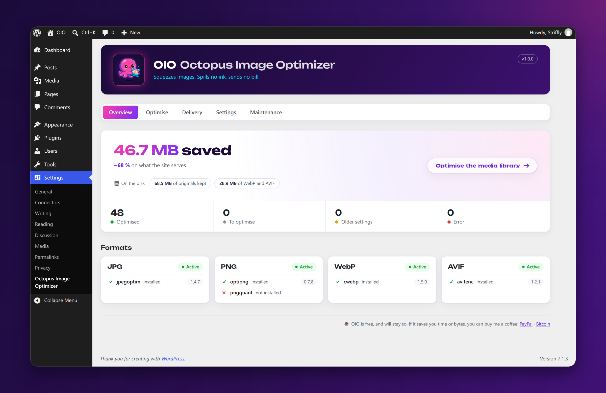
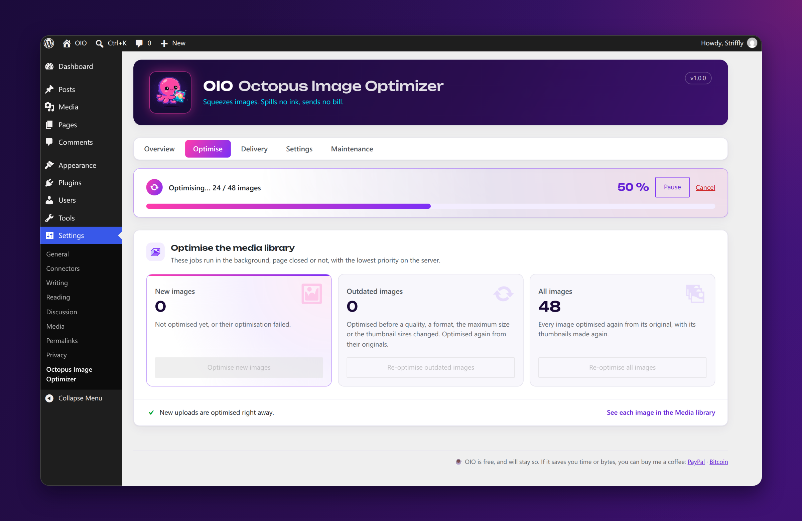
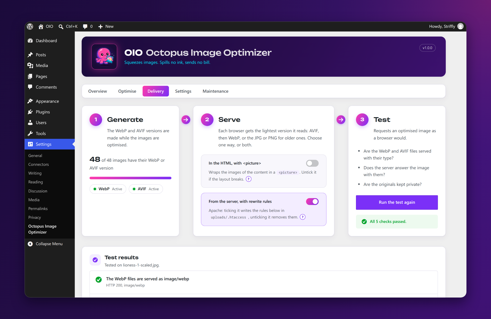
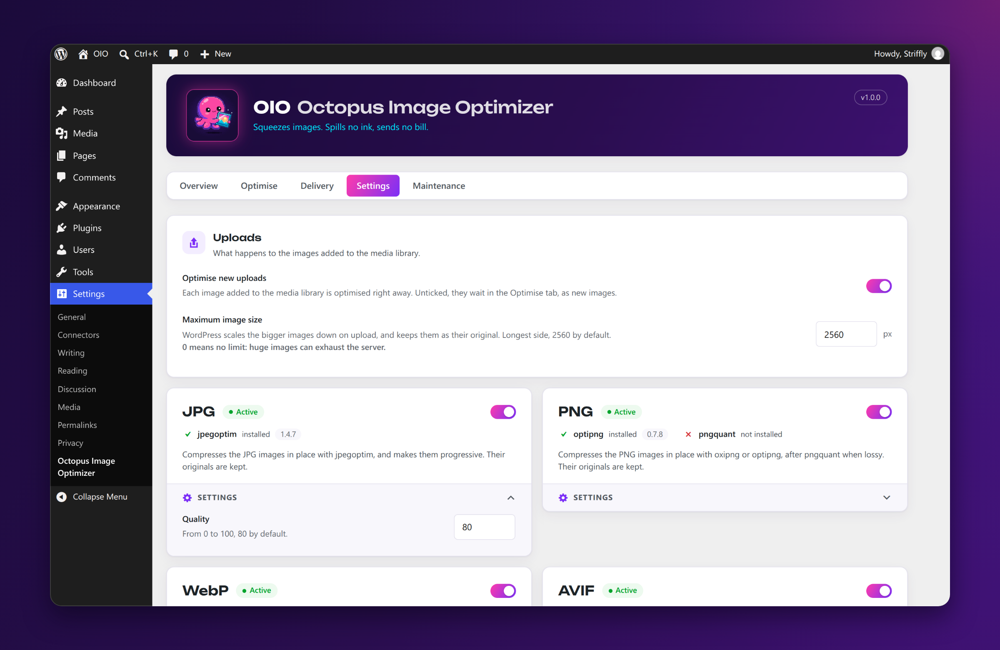
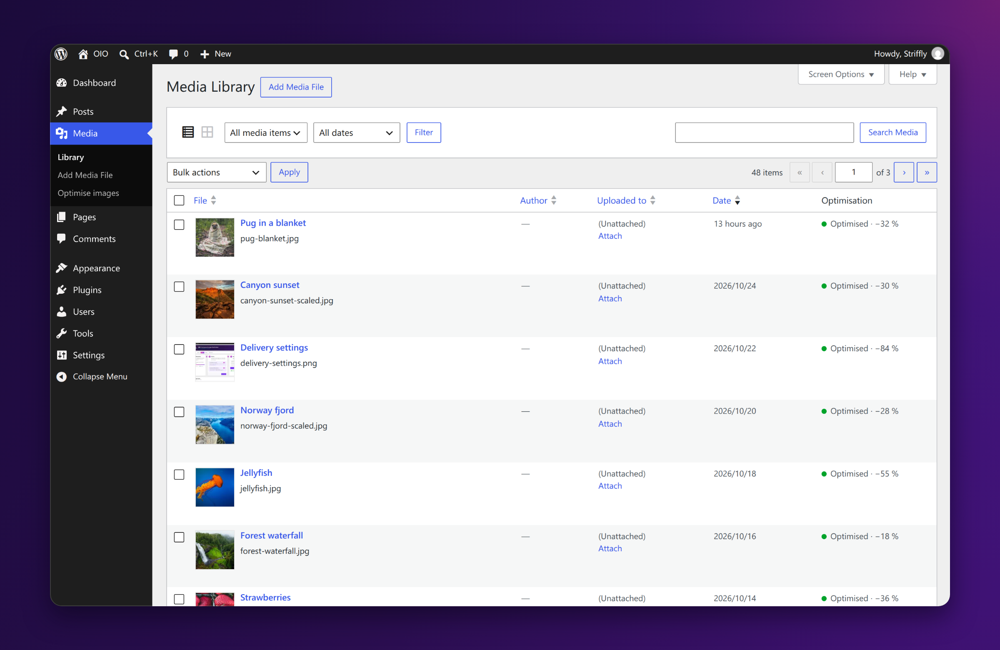

<p align="left">
    
</p>

# OIO – Octopus Image Optimizer

🐙 **Squeezes images. Spills no ink, sends no bill.**

[](https://www.gnu.org/licenses/gpl-3.0.en.html)


[Features](#features) · [Screenshots](#screenshots) · [Requirements](#requirements) · [Installation](#installation) ·
[FAQ](#faq) · [Developers](#developers) · [Changelog](CHANGELOG.md) · [Support](#support)

OIO optimises the images of your WordPress media library with the libraries of your own server: `jpegoptim`,
`optipng` or `oxipng`, `pngquant`, `cwebp` and `avifenc`, or GD and Imagick for the WebP and AVIF formats. Free and
unlimited, no API key, no quota: your images never leave your server.

## Features

**Optimisation**

- Compresses JPG and PNG images in place, and creates their WebP and AVIF versions in `uploads/octopus/formats/`,
  with the same tree (`2026/10/photo.jpg.webp`, `photo.jpg.avif`), kept only when lighter than the compressed image.
  WordPress never writes there: no file added to the media library can pass for a version of an image.
- Keeps the original images: every optimisation starts again from them, and they can be restored at any time.
- Strips the metadata (camera, date, GPS position) from every optimised file, but the colour profile the colours
  need, e.g. the Display P3 of a phone: an sRGB one goes, the colours of an image without one.
- Handles CMYK JPGs, which the WebP and AVIF encoders cannot read, and the photos stored sideways, which they would
  leave sideways: the browsers turn the JPG from its Exif data.

**Media library**

- Optimises the images on upload (optional), scaled down to a maximum size (2560 pixels by default, as WordPress does).
- Optimises, re-optimises or cleans up the whole library in the background, with a progress bar, pause and cancel.
  The job goes on when the page is closed.
- Spots the images optimised with older settings, or before the theme changed its image sizes, and makes their
  thumbnails again from the originals, scaled to the current maximum size.
- Shows the status of each image in the media library, and its errors in plain words.
- Optimises or restores an image right from the media library.
- Shows the bytes saved, on each image of the media library and on the whole library, with what serving WebP and
  AVIF would save, and the disk used by the originals and the WebP and AVIF files.

**On the site**

- Serves AVIF and WebP, with the JPG or PNG as fallback (optional): in a `<picture>` element, or from the server
  with rewrite rules (written for Apache, given for nginx), which leaves the HTML as it is.
- Tests the delivery: types sent by the server, rewrite, originals kept private.

For themes, `octopus_image()` and `octopus_image_sources()` give the `<picture>` of an image or its srcsets: see
[Developers](#developers).

## Screenshots



<details>
<summary>The optimisation, the delivery, the settings and the media library</summary>









</details>

## Requirements

- WordPress 6.2 and PHP 8.2 or later.
- The JPG and PNG compression needs `jpegoptim` and `optipng` or `oxipng` installed on the server, and PHP allowed to
  run them (`proc_open()` or `exec()`). Linux and macOS have them; Windows has no official build of `jpegoptim` and
  `optipng`.
- The WebP and AVIF formats work without their libraries, with GD or Imagick when they support them (AVIF since
  WordPress 6.5). `cwebp` and `avifenc` are better: they run apart from PHP, `cwebp` makes the PNG graphics much
  lighter and `avifenc` keeps their colours sharper.

The settings page shows the missing libraries and how to install them, e.g. on Debian or Ubuntu:

```bash
sudo apt install jpegoptim optipng webp libavif-bin
```

On Windows, put the official builds of [`cwebp`](https://developers.google.com/speed/webp/download) and
[`avifenc`](https://github.com/AOMediaCodec/libavif/releases) on the `PATH`, or give their path with the
`octopus_binary_path` filter: the WebP and AVIF formats are tested on Windows by a GitHub Action, the JPG and PNG are not
compressed there.

Each format works on its own: a missing library only turns its format off, or hands the WebP or AVIF to GD or
Imagick. `oxipng`, faster than `optipng`, replaces it
when installed (`apt install oxipng` on recent systems, or from its
[releases](https://github.com/oxipng/oxipng/releases)), and `pngquant` (`apt install pngquant`) adds an optional lossy
compression of the PNG images.

## Installation

1. Download the zip of the latest [release](https://github.com/Striffly/octopus-image-optimizer/releases).
2. Upload it in `Plugins > Add New > Upload Plugin`, and activate it.
3. Open `Settings > OIO`: the Overview tab checks the libraries.
4. Click `Optimise new images` to optimise the images already in the library.

To install it from this repository instead, run `composer install` in the plugin folder: it builds the dependencies
in `vendor-prefixed/`. To build the zip of a release, run `bun install` then `bun run release:zip` (Composer, Bun,
Node.js 22 or later and `zip` needed): it makes `octopus-image-optimizer.zip`.

## FAQ

### Does OIO replace my images?

By default, yes: the JPG and PNG files are replaced by their compressed version, so the whole site uses them right
away, and their originals are kept in `uploads/octopus/originals-{key}/`. `Restore original images` on the settings page,
or `Restore original` on an image of the media library, puts them back. To leave the files as they are, untick
`Compress JPG images` or `Compress PNG images` on the Settings tab: OIO then only makes their WebP and AVIF versions.

### Does it serve WebP and AVIF automatically?

Once turned on, on the Delivery tab, in one of two ways:

- **In the HTML**: the images of the content and the ones output by `wp_get_attachment_image()` (featured images,
  galleries, most themes) are wrapped in a `<picture>` element, with the JPG or PNG as fallback. Works everywhere,
  but may break a layout styling `img` directly. In a custom theme, use [`octopus_image()`](#theme-development).
- **From the server**: the server answers `photo.jpg` with `octopus/formats/…/photo.jpg.avif` or `.webp` when the
  browser reads them. The HTML does not change and every image is served, CSS backgrounds included. OIO writes the rules in
  `uploads/.htaccess` on Apache and LiteSpeed; on nginx, add these ones to the configuration of the site:

```nginx
# In the http block:
map $http_accept $octopus_avif {
	default "";
	"~image/avif" ".avif";
}
map $http_accept $octopus_webp {
	default "";
	"~image/webp" ".webp";
}

# In the server block:
location ~* ^/wp-content/uploads/(?<octopus_file>.+\.(?:jpe?g|png))$ {
	add_header Vary Accept;
	try_files /wp-content/uploads/octopus/formats/$octopus_file$octopus_avif /wp-content/uploads/octopus/formats/$octopus_file$octopus_webp $uri =404;
}
```

A CDN must vary its cache on the `Accept` header, or serve the JPG to everyone. `Test the delivery`, on the same
tab, checks what the server sends.

### What happens when the theme changes its image sizes?

The images optimised before are listed as "Older settings". `Re-optimise outdated images` makes their thumbnails again
from the originals, and optimises them.

### Does it slow the site down?

The background jobs run the libraries with the lowest priority: the requests of the site go first. On a small server,
the [filters](#filters) slow the jobs down further.

### Does it work on shared hosting?

Yes for the WebP and AVIF formats: without their libraries, or where PHP cannot run programs, GD or Imagick make
them. The JPG and PNG compression needs the libraries installed and PHP allowed to run them: most shared hosts do not
let you install them, ask your host. The Overview tab tells what is missing.

### What happens when I deactivate or delete OIO?

Deactivated, OIO stops its background job and removes its rewrite rules from `uploads/.htaccess`: the site serves
the JPG and PNG images again. Its settings and files stay, and the rules come back when it is activated again.

Deleted, its settings and data are removed from the database, and the files stay: the compressed images, their WebP and AVIF
versions and the originals. To get your original images back, run `Restore original images` before deleting OIO,
which reminds it when it is deactivated.

### Which settings do the libraries use?

Every optimisation starts from the original image:

```bash
jpegoptim --strip-all --all-progressive --overwrite --max={quality} photo.jpg
optipng -clobber -strip all -o {level} -out photo.png octopus/originals-{key}/photo.png
oxipng -o {level} --strip safe --force --threads {threads} --out photo.png octopus/originals-{key}/photo.png
pngquant --quality={quality - 15}-{quality} --strip --skip-if-larger --force --output tmp.png -- octopus/originals-{key}/photo.png
cwebp -q {quality} photo.jpg -o octopus/formats/photo.jpg.webp
avifenc -q {quality} --ignore-exif --ignore-xmp --speed {speed} --jobs {threads} photo.jpg octopus/formats/photo.jpg.avif
```

`avifenc` older than 1.0 gets the quality as `cq-level` instead of `-q`, and its speed is 6 by default (settings).
`oxipng` runs instead of `optipng` when installed, after `pngquant` when the PNG compression is lossy (it then
compresses `tmp.png`). The libraries run on several files of an image at once, within `octopus_threads` (4 on upload, 2
in background jobs): `avifenc` and `oxipng` get the threads left, `{threads}`. A PNG is also encoded with
`cwebp -near_lossless 60`, kept if lighter: graphics and screenshots get much lighter and sharper, photos are left
lossy.

Without `cwebp` or `avifenc`, the WordPress image editor (GD or Imagick) makes the WebP at the same quality, and the
AVIF at the quality + 5 (up to 89, from 90 as is), for files close to the ones of `avifenc`. The PNG images are not
tried in near-lossless.

## Privacy

OIO sends nothing out of your server: no API, no tracking, no external request. The delivery test only requests the
images of the site, from its CDN if they are served by one.

The optimised images lose their metadata, but the originals keep them, GPS position included. They are kept in
`uploads/octopus/originals-{key}/`, the key drawn at random for each site: their URL cannot be guessed from the one of
an image. OIO also writes a `.htaccess` denying the web access to that folder, which works with Apache and LiteSpeed.
With nginx, add this rule to the `server` block of the site (it is in the rules of the Delivery tab):

```nginx
location ^~ /wp-content/uploads/octopus/originals- {
	deny all;
}
```

Or keep the originals out of the web root with the `octopus_backup_dir` filter, before optimising any image. OIO does not
move the originals already kept: move the folder yourself when you change it.

```php
// e.g. next to the web root of a Bedrock site.
add_filter('octopus_backup_dir', function () {
	return dirname(ABSPATH, 2) . '/octopus-originals';
});
```

## Developers

### Theme development

The `<picture>` option of the Delivery tab serves the WebP and AVIF versions for the images of the content and the
ones output by `wp_get_attachment_image()`. The images a theme outputs with its own markup, e.g. from an ACF field,
are left as they are: serve them from the server, or use `octopus_image()`, which returns their `<picture>` element
whatever the options.

```php
if (function_exists('octopus_image')) {
	echo octopus_image($image_id, 'hero');       // Class of the <picture> element.
	echo octopus_image($image_id, 'hero', true); // data-src and data-srcset, for a JavaScript lazy loader.
}
```

```html
<picture class="octopus-picture hero">
	<source type="image/avif" srcset="octopus/formats/photo.jpg.avif 2500w, octopus/formats/photo-300x200.jpg.avif 300w" sizes="(max-width: 2500px) 100vw, 2500px">
	<source type="image/webp" srcset="octopus/formats/photo.jpg.webp 2500w, octopus/formats/photo-300x200.jpg.webp 300w" sizes="(max-width: 2500px) 100vw, 2500px">
	
</picture>
```

A theme writing its own `<picture>` (lazy loading, preview…) can ask for the sources only: `octopus_image_sources()`
takes a srcset, or a single image URL, and returns the srcset of each format with files, keyed by MIME type, best first.
A size without a file in a format (deleted as heavier than its JPG or PNG) keeps its JPG or PNG in that srcset.

```php
$sources = function_exists('octopus_image_sources') ? octopus_image_sources($srcset) : [];
// ['image/avif' => 'octopus/formats/photo.jpg.avif 2500w, photo-300x200.jpg 300w',
//  'image/webp' => 'octopus/formats/photo.jpg.webp 2500w, octopus/formats/photo-300x200.jpg.webp 300w']

foreach ($sources as $type => $format_srcset) {
	printf('<source type="%s" srcset="%s" sizes="%s">', esc_attr($type), esc_attr($format_srcset), esc_attr($sizes));
}
```

Keep the `function_exists()` check: without it, the pages break while OIO is deactivated.

### WP-CLI

| Command              | What it does                                                                         |
|----------------------|--------------------------------------------------------------------------------------|
| `wp octopus health`  | Checks that the libraries are installed.                                             |
| `wp octopus run`     | Optimises the whole media library, with the settings of the settings page.           |
| `wp octopus clean`   | Removes the WebP and AVIF files. The JPG and PNG files stay compressed.              |
| `wp octopus restore` | Restores the original images and removes every file made by OIO.                     |
| `wp octopus stats`   | Prints the bytes saved on the media library. `--rebuild` measures every image again. |
| `wp octopus version` | Shows the version of OIO.                                                            |

`wp octopus run` takes these options, listed by `wp help octopus run`:

- `--force` optimises the images again, `--regenerate` first makes their thumbnails again from the originals,
  `--thumbnails-only` leaves the full size images out.
- `--no-jpg`, `--no-png`, `--no-webp`, `--no-avif` turn a format off, `--jpg`, `--png`, `--webp`, `--avif` on.
- Each setting of a format overrides the settings page under the same name: `--jpg-quality`, `--png-compression`,
  `--png-level`, `--png-lossy-quality`, `--webp-quality`, `--avif-quality` and `--avif-speed`.

`wp octopus run` exits with an error when images fail, e.g. in a deployment script.

`wp octopus stats` first measures the images optimised before OIO counted the bytes saved, from the sizes of their files:
nothing is encoded again.

### Filters

| Filter                                | Default                                        | Sets                                                   |
|---------------------------------------|------------------------------------------------|--------------------------------------------------------|
| `octopus_backup_dir`                  | `uploads/octopus/originals-{key}`              | The folder of the original images.                     |
| `octopus_nice`                        | `19` in background jobs, `0` otherwise         | The priority of the libraries, `0` (normal) to `19`.   |
| `octopus_threads`                     | `4` on upload, `2` in background, `all` in CLI | The threads of the libraries at once, all together.    |
| `octopus_timeout`                     | `120`                                          | Seconds a library may take on a file, then stopped.    |
| `octopus_job_seconds_between_batches` | `0`                                            | A pause after each image of a background job, seconds. |
| `octopus_job_default_time_limit`      | `20`                                           | The duration of a batch of a background job, seconds.  |
| `octopus_binary_path`                 | Found in the `PATH`, then `/usr/bin`...        | The path of a library, or `false` to turn it off.      |

`octopus_nice` and `octopus_threads` receive the context as second argument: `upload`, `background` or `cli`. Within
`octopus_threads`, OIO runs the libraries on several files of an image at once: `cwebp`, `jpegoptim`, `optipng` and
`pngquant` take one thread each, `avifenc` and `oxipng` the threads left. On multisite, the two job filters carry the
ID of the site: `octopus_2_job_default_time_limit` on the site 2.

`octopus_binary_path` receives the name of the library as second argument (`jpegoptim`, `optipng`, `cwebp`, `avifenc`,
or `nice`); without `cwebp` or `avifenc`, GD or Imagick make the format. OIO looks the libraries up in the folders of
the `PATH`, then in `/usr/bin`, `/usr/local/bin`, `/bin`, `/opt/homebrew/bin` and `/opt/local/bin`: PHP-FPM often
passes an empty `PATH`.

```php
// In a mu-plugin: lighter background jobs on a small server.
add_filter('octopus_threads', function ($threads, $context) {
	return $context === 'background' ? 1 : $threads;
}, 10, 2);

// A library installed out of the usual folders.
add_filter('octopus_binary_path', function ($path, $name) {
	return $name === 'avifenc' ? '/home/me/bin/avifenc' : $path;
}, 10, 2);
```

### Tests

The integration tests run on the test suite of WordPress, with the libraries installed: they upload images and check
the files on the disk. `composer install` installs PHPUnit, the WordPress test library and WordPress itself. They need
a MySQL or MariaDB database of their own, emptied at each run: never the one of a site.

```bash
composer install
# The database, by default wordpress_test on 127.0.0.1 as root without password.
export WP_TESTS_DB_NAME=wordpress_test WP_TESTS_DB_USER=root WP_TESTS_DB_PASSWORD=root WP_TESTS_DB_HOST=127.0.0.1:3306
composer test             # On a single site.
composer test:multisite   # On a network.
```

A test needing a library that is not installed is skipped. The GitHub workflow runs them on PHP 8.2 and 8.4, on a
single site and on a network, at each push and before each release.

### Translations

OIO is written in English and translated in French, in `languages/`. Once OIO is on WordPress.org, its translations
come from [translate.wordpress.org](https://translate.wordpress.org/), and come before the ones of `languages/`. After
changing a text, update the template and the translations with [WP-CLI](https://wp-cli.org/):

```bash
composer translations   # The .pot, then the .po, .mo, .l10n.php and .json of each language.
```

### Logo and banner

`bun run brand` draws the logo and the banners from the pixel grids of `tools/brand/sprites/`, in `assets/images/`
and `.wordpress-org/`, the assets of the page of OIO on WordPress.org. The screenshots there are captures of the
admin, 1408x880 at 2x, dressed by `tools/brand/screenshots.js` in the order of `readme.txt`:

```bash
bun tools/brand/screenshots.js overview.png optimise.png delivery.png settings.png media.png
```

## Support

OIO is free, and will stay so. If it saves you time or bytes, you can buy me a coffee ☕:

- **PayPal**: [paypal.me/striffly](https://paypal.me/striffly/5EUR)
- **Bitcoin**: `bc1q3j7gxxykpu9zp3sgxyallw0hq0sr659zl35wre`


## Credits

OIO is developed by [Clément Gayot](https://github.com/Striffly).

It started as a fork of [Squidge](https://github.com/ainsleyclark/squidge), created by
[Ainsley Clark](https://github.com/ainsleyclark) in 2021 with contributions from Roman K, Rohinish and karbivskij, and
was largely rewritten in 2026. Many thanks to them for the foundations: the idea of relying on the native libraries
of the server comes from Squidge.

Thanks also to [Media Optimizer](https://wordpress.org/plugins/yoohw-media-optimizer/) by YooHW for some ideas: the menu, the delivery page, the display of the bytes saved, and more.

## License

OIO is free software, released under the [GNU General Public License v3](LICENSE) or later.
