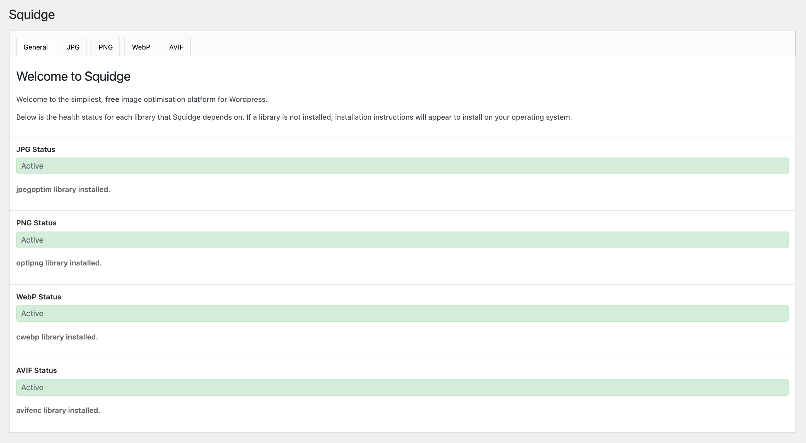
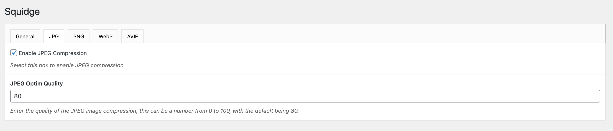

<p align="left">
    
</p>

# OIO – Octopus Image Optimizer

**Squeezes images. Spills no ink, sends no bill.**

OIO compresses JPG and PNG images and converts them to WebP and AVIF on your own server, with `jpegoptim`, `optipng`,
`cwebp` and `libavif`. Free, unlimited, no API key: your images never leave your server.

[](https://www.gnu.org/licenses/gpl-3.0.en.html)


## Why?

Image compression in WordPress can be costly, confusing and sometimes just simply don't work. We have aimed to simplify
the process by requiring the developer to install the required package on the operating system and OIO does the
hard work for you.

- **IT'S FREE**
- Unlimited file size, no limits.
- Optimised for your site to rank.
- CLI to regenerate all of your media files.
- Helper functions to output images in templates.
- Uses the native `cwebp` and `libavif` libraries.

## What does OIO do?

OIO compresses and converts image files when the user has uploaded a file to WordPress.
The original images are kept in `uploads/oio-originals/` (same tree as the uploads folder), and every
optimisation starts again from them.

Compresses JPG images in place using `jpegoptim`.

Compresses PNG images in place using `optipng`.

Converts JPG and PNG images to `.webp` files using `cwebp` with the appended extension  e.g. `image.jpg.webp`.

Converts JPG and PNG images to `.avif` files using `libavif` with the appended extension  e.g. `image.jpg.avif`.

## Installation

1. Go to the [releases](https://github.com/Striffly/squidge/releases) section and download the plugin.
2. Upload the `octopus-image-optimizer` plugin to your `/wp-content/plugins/` directory.
3. Activate the plugin through the "Plugins" menu in WordPress.
4. Check the Settings tab under `Settings | OIO` to ensure the libraries are installed, if they aren't,
   run the commands listed dependent on your operating system.
5. Check the individual optimisation tabs and adjust settings accordingly.
6. Done!

To install the plugin from this repository instead of a release, run `composer install` in its folder: it installs
the dependencies in `vendor-prefixed/`, with their classes prefixed by [Strauss](https://github.com/BrianHenryIE/strauss)
so that they cannot collide with the copies other plugins load.

## Render Images

The compressed JPG and PNG files replace the originals, so your whole site uses them. There are two ways to also
offer the AVIF and WebP versions.

**Automatically**: on the `Overview` tab of the settings, tick `Use modern formats (WebP, AVIF)`. Images of the post
content and images rendered by `wp_get_attachment_image()` (featured images, galleries, most themes) are then wrapped
in a `<picture>` element with AVIF and WebP sources. This option is off by default.

**In templates**: the `oio_image` helper function always returns a `<picture>` element with the AVIF and WebP
versions that exist on the file system, whatever this option.

### Function
```php
/**
 * Returns a <picture> element for an image of the media library: AVIF
 * and WebP <source> elements (when their files exist), then the 
 * with the srcset and sizes computed by WordPress as the fallback.
 *
 * - If lazy is true, the data-src or data-srcset will be used instead.
 * - If a class is set, the class will be outputted on the <picture> element.
 *
 * @param $image_id
 * @param string $class
 * @param false $lazy
 * @return string
 */
function oio_image($image_id, $class = '', $lazy = false)
```

### Output
```html
<picture class="oio-picture hero">
	<source type="image/avif" srcset="/sample-image.jpg.avif 2500w, /sample-image-300x200.jpg.avif 300w" sizes="(max-width: 2500px) 100vw, 2500px">
	<source type="image/webp" srcset="/sample-image.jpg.webp 2500w, /sample-image-300x200.jpg.webp 300w" sizes="(max-width: 2500px) 100vw, 2500px">
	
</picture>
```

## Screenshots

### Plugin settings page



### Example compression tab



## FAQs

### Does the plugin replace existing images?

Yes, the JPG and PNG files of the uploads folder are replaced with their compressed version, so your whole site
uses them. The originals are kept in `uploads/oio-originals/` and every new optimisation starts again from them.

### What happens when I delete OIO?

Deleting OIO removes its settings and data from the database, and keeps the files: the compressed images, their
WebP and AVIF versions and the originals in `uploads/oio-originals/`. To get your original images back and remove
every OIO file, run `Restore original images` on the settings page (or `wp oio restore`) before deleting it.
OIO reminds it when it is deactivated.

### What are the supported operating systems?

Windows, Linux, & Mac OSX.

### How are JPGs optimized?

```bash
# input-file.jpg is first restored from its original in uploads/oio-originals/
jpegoptim --strip-all --overwrite --max={{ quality }} input-file.jpg
```

### How are PNGs optimized?

```bash
optipng -clobber -strip all -o {{ optimization }} -out input-file.png oio-originals/input-file.png
````

### How are images converted to webp files?

```bash
cwebp -q {{ quality }} input-file.jpg -o input-file.jpg.webp
```

### How are images converted to avif files?

```bash
avifenc -q {{ quality }} --speed 6 input-file.jpg input-file.jpg.avif
```

With libavif older than 1.0, `-q` does not exist and the quality is passed as the equivalent `cq-level`:

```bash
avifenc --min 0 --max 63 -a end-usage=q -a cq-level={{ (100 - quality) * 63 / 100 }} --speed 6 -a tune=ssim input-file.jpg input-file.jpg.avif
```

## CLI

OIO includes a built in `WP CLI` to help convert and compress images, you can see the commands below.

```bash
wp oio
```

```bash
usage: wp oio health
   or: wp oio run
   or: wp oio version
```

### Version

Outputs the current version number of OIO.

```bash
wp oio version
```

### Health

Checks the correct libraries are installed.

```bash
wp oio health
```

### Run

Compresses and converts all images. This command will obtain images from the WP media library, compress them if they are
JPG/PNG's and convert them to the `.webp` and `.avif` file formats.

By default all optimisation methods are ran, but you can disable them using the arguments below.

**Simple example:**

```bash
wp oio run
```

**With example arguments**

```bash
wp oio run --jpeg=false --quality=80 --optimization=o3
```

#### Arguments

The formats and qualities default to the ones of the options page, the arguments override them.

| Argument        | Default Value | Accepted Values          | Description       |
|-----------------|---------------| ------------------------ | ----------------- |
| jpg             | options page  | `true`/`false`           | If JPG compression should run.
| png             | options page  | `true`/`false`           | If PNG compression should run.
| webp            | options page  | `true`/`false`           | If WebP conversion should run.
| avif            | options page  | `true`/`false`           | If AVIF conversion should run.
| quality         | options page  | `0` to `100`             | Quality of JPG compression and WebP conversion.
| optimization    | options page  | `o0` to `o7`             | Optimisation of PNG images.
| avif-quality    | options page  | `0` to `100`             | Quality of AVIF images.
| avif-speed      | `6`           | `0` to `10`              | Speed of the AVIF encoder. 0 to 6 make files of about the same size (0 is much slower), faster speeds make larger files.
| force           | `false`       | `true`/`false`           | Force reoptimization of already optimized images.
| regenerate      | `false`       | `true`/`false`           | Make the thumbnails again from the original images first (implies force), e.g. after the theme changed its image sizes.
| thumbnails-only | `false`       | `true`/`false`           | Optimize only thumbnails.

### Clean

Removes the WebP and AVIF files of all images. The JPG and PNG files stay compressed.

```bash
wp oio clean
```

### Restore

Restores the original images and removes every file made by OIO (WebP, AVIF, backups). Do it before deleting
OIO to get your original images back. An image whose original was deleted from
`uploads/oio-originals/` stays compressed.

```bash
wp oio restore
```

## Performance

The libraries run with settings that suit most servers:

- in the background jobs (bulk optimisation, clean up), every library runs with the lowest priority (`nice -n 19`,
  when available): the requests of the site go first, and the jobs use the CPU left. `avifenc`, the only library using
  several cores, uses 2 threads,
- on upload and in the media library actions, `avifenc` uses 4 threads, about as fast as all cores on a photo,
- in WP-CLI, `avifenc` uses all cores.

Filters adjust them, by context (`upload`, `background` or `cli`), e.g. in a mu-plugin:

```php
// Priority of the libraries, from 0 (normal) to 19 (lowest). Default: 19 in background, 0 otherwise.
add_filter('oio_nice', function ($level, $context) {
	return $context === 'background' ? 19 : 10;
}, 10, 2);

// Threads of avifenc: a number or "all". Default: 4 on upload, 2 in background, all in WP-CLI.
add_filter('oio_avif_jobs', function ($jobs, $context) {
	return 1;
}, 10, 2);

// Pause after each image of a background job, in seconds. Default: 0.
add_filter('oio_job_seconds_between_batches', function () {
	return 1;
});

// Duration of a batch of a background job before it starts again, in seconds. Default: 20.
add_filter('oio_job_default_time_limit', function () {
	return 10;
});
```

## Road Map

- Add `SVGO` to optimise SVG images.
- More arguments passed to each service.
- Update meta data when images are converted or compressed.
- Output compression info in the Media Library.
- Create unit tests.

## Credits

OIO is developed by [Clément Gayot](https://github.com/Striffly).

It started as a fork of [Squidge](https://github.com/ainsleyclark/squidge), created by
[Ainsley Clark](https://github.com/ainsleyclark) in 2021 with contributions from Roman K, Rohinish and karbivskij, and
was largely rewritten in 2026. Many thanks to them for the foundations: the idea of relying on the native libraries
of the server comes from Squidge.
